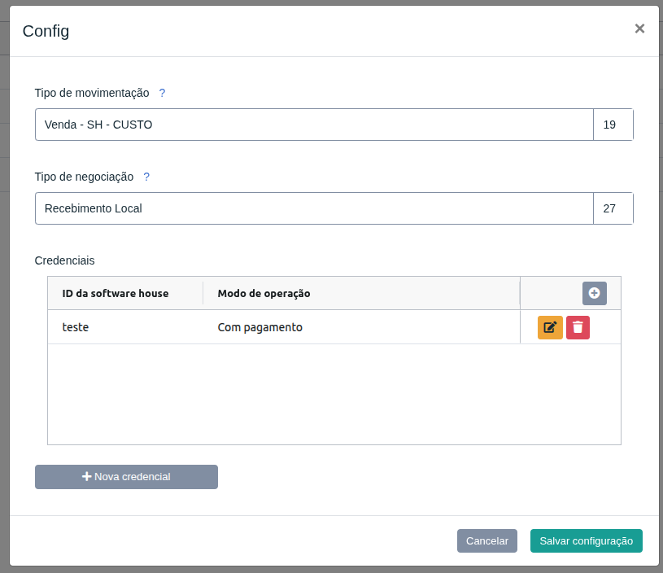
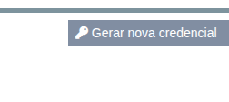
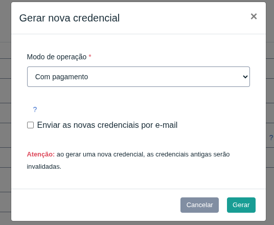
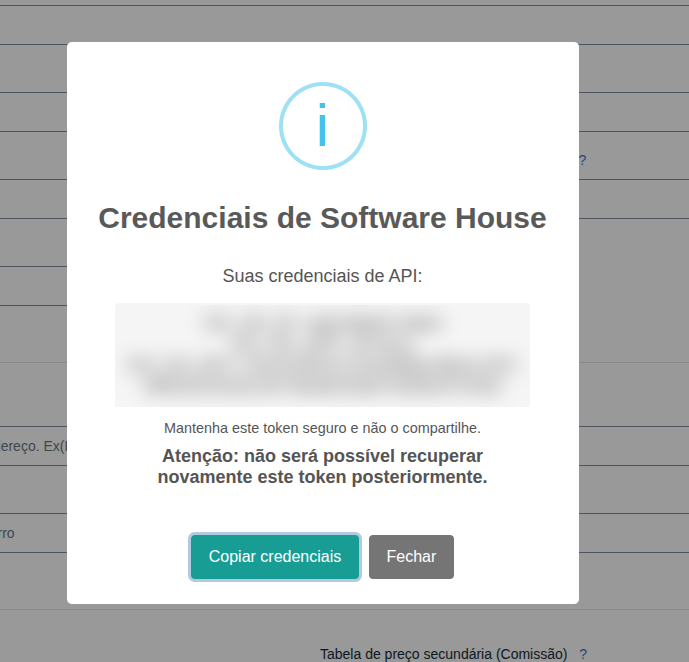

## API Software House

A API de Software House permite que quem estiver integrando possa realizar a solicitação de um novo certificado digital e a emissão do certificado embarcado no sistema da Software House.

# Configurar a extensão no Gestão Online

Para começar, acesse a extensão de **Software House** no Marketplace e clique no botão **Configurações**. Será exibida a janela de configuração com dois campos:

- **Tipo de movimentação:** define qual tipo de movimentação será utilizado caso o modo de operação utilizado seja *Sem pagamentos* (Ex.: *Venda - SH - CUSTO*).
- **Tipo de negociação:** define qual tipo de negociação será utilizado será utilizado caso o modo de operação utilizado seja *Sem pagamentos* (Ex.: *Recebimento Local*).

⚠️ Para integração que utiliza o modo de operação "Com pagamentos", será utilizado as configurações definidas em *Venda Online*.

Selecione as opções desejadas e clique em **Salvar configuração**.

    

# Gerar um novo token

Com a extensão configurada, acesse a tela de **Unidade** e clique no botão **Gerar nova credencial**.

    

Será aberta a janela **Gerar nova credencial**. Nela, selecione uma das opções do campo **Modo de operação**:

- **Com pagamento**
- **Sem pagamento**

Você também pode marcar a opção **Enviar as novas credenciais por e-mail**. Com ela marcada, as credenciais geradas serão enviadas por e-mail para o cliente.

⚠️**Atenção:** ao gerar uma nova credencial, as credenciais antigas serão invalidadas. Qualquer sistema que esteja usando o token anterior deixará de funcionar até ser atualizado com o novo.

Para finalizar, clique em **Gerar**.

    

# Copiar as credenciais

Após a geração, será exibida uma janela com as suas credenciais de API:

- **GO_SH_ID:** identificador da Software House.
- **GO_SH_APP:** identificador da AR.
- **GO_SH_KEY:** chave de acesso (token).

Clique em **Copiar credenciais** para copiá-las e guarde-as em um local seguro.

⚠️**Importante:** não será possível recuperar este token posteriormente. Caso o perca, será necessário gerar uma nova credencial, o que invalidará a atual. Mantenha-o seguro e não o compartilhe.

    

